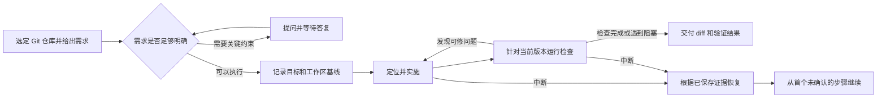

# VastMind CLI 架构定稿

## 产品定位

VastMind 是一个面向真实代码仓库的 Coding Agent。用户在终端提出开发功能、修 Bug、重构或代码审查的要求，VastMind 在选定项目中理解代码、实施变更、运行检查并交付结果。简单任务即时完成，复杂任务沿用同一个会话分步执行，用户可随时查看进度、停止或恢复。

首个可用版本交付本地 CLI。CLI 与编码执行核心使用独立模块，MCP 或 API 适配器在 CLI 验收后实现，供 Aurora 将 VastMind 作为专用 Coding Agent 接入。

## 第一版用户流程

- `vastmind` 进入交互会话。`vastmind run "修复登录失败"` 发起单次任务。`vastmind resume <会话 ID>` 恢复已有任务。`vastmind eval` 运行固定评测。
- 开工前展示仓库、目标和执行位置。需求中缺少会改变实施方向的条件时，先问清楚。用户说「继续」时恢复当前会话，明确的新指令可更新任务目标并保留变更记录。
- 执行期间展示已完成的阶段、正在运行的检查和待用户处理的事项。范围清楚的小修改直接执行，跨模块工作按可验证的阶段推进。
- 最终交付包含改动摘要、diff、实际运行的检查和未验证项。默认在任务工作区保留补丁，用户明确选择后才把修改应用回原工作区、提交或推送。

## 实现边界

| 模块 | 职责 |
| --- | --- |
| CLI | 终端交互、权限请求、流式进度、diff 和回执展示。 |
| 编码核心 | 保存目标、选择下一步、调用模型和工具、处理停止与恢复。 |
| 工作区与工具 | 识别 Git 仓库，读取、搜索、写补丁、运行命令，生成工作区指纹。 |
| SQLite 与产物目录 | SQLite 保存会话、事件顺序、动作状态、审批和回执。磁盘保存工作区、日志和大体积产物，通过 ID 和摘要关联。 |
| 评测 | 用固定仓库和验收规则复现任务，记录通过率、耗时、模型调用与工具开销。 |

技术栈沿用 TypeScript、Node.js、Vitest 和 OpenAI 兼容 HTTP。模型与工具调用使用结构化事件。上下文压缩可以归纳旧对话，保留关键决策和工具调用与结果的对应关系。恢复所需的目标、审批和执行事实从 SQLite 及产物目录重建。

## 四项执行规则

### 1. 仓库、权限和变更

- 每次任务绑定仓库根目录、基线提交及目标工作区。原工作区干净时可创建独立 Git worktree。已有未提交修改时，明确选择是否带入这些修改，并记录对应的基线差异。交付 diff 只展示本任务带来的变化。
- 文件工具校验解析后的真实路径，补丁带原内容版本检查。任务工作区内只允许一个活跃写入者。应用补丁前核对原工作区相关文件，遇到冲突时保留补丁并展示冲突位置。
- 文件和命令工具遵循现有授权范围。Shell 的隔离取决于实际执行环境。运行命令时明确工作目录、参数和授权范围，命令具备网络或宿主目录访问能力时应准确显示。提交和推送分别按用户明确授权执行。

### 2. 程序根据真实回执验收

- 开工时保存用户希望得到的结果和明确的验收条件。模型负责规划、实施、解释问题和提出检查。程序负责校验动作范围、记录执行事实、判断工作区状态和检查结果。
- 文件完整性、补丁是否应用和命令退出状态使用工具实测。语义质量可以交给模型评审，模型的意见单独展示，并记录为待验证项或返修线索。
- 每次检查记录命令、工作目录、所检查的版本、退出状态、测试统计和日志。通过、失败、超时、跳过与未运行分别显示。生成新补丁后，旧回执可供追溯，需要重新核对受影响的检查。
- 重要 Bug 回归用例尽可能先在原版本复现，再验证修复后的版本。评测夹具和评测执行器由 Vitest 测试环境控制，评测的通过条件独立于 Agent 可修改的文件。

### 3. 中断后从已确认的步骤继续

- 有副作用的动作先保存操作 ID、计划输入、权限和目标版本，执行后保存可核对的回执。关键文件变更保存前后指纹。用户可关闭终端后用原会话 ID 恢复。
- 续跑时先核对已有回执、工作区和执行进程。已确认写入且当前文件匹配时直接继续。比如补丁已经落盘、回执尚未来得及保存，先比较预期内容和现有文件，再补齐记录或报告冲突。
- 对结果未知的命令，先判断进程是否仍在运行、是否已有产物以及是否可安全重试。涉及不可安全重试的外部副作用时，保留待确认状态。已验证的阶段只在输入发生变化时重新检查。
- `Ctrl+C` 停止发起新动作，终止本会话的活动子进程树并保留已确认的变更。长任务分成有边界的阶段，每段可独立保存与恢复。工具预算、超时和修复次数随会话保存。

### 4. 进度和任务状态

- 程序根据回执生成阶段进度，例如「补丁已保存，正在跑登录相关测试」。模型生成的解释可以流式显示，阶段结果跟随实际执行状态。
- 会话区分进行中、等待用户、已停止、已完成和阻塞。只有当前版本满足明确的验收条件时才标记完成。服务异常或检查超时时，交付已确认的成果并列出待处理项。

## 开发顺序与首版验收

1. **跑通一次真实修改。** 先完成仓库识别、读搜改、命令执行和最小事件存储。用一个小仓库跑通「复现失败 → 修改 → 复测 → 查看 diff」。
2. **完成保护与恢复。** 对含未提交改动的仓库测试隔离和冲突处理。在补丁保存后、回执保存前中断，再用 `resume` 确认只继续待完成步骤。验证停止时子进程退出、已确认的工作可继续。
3. **跑固定回归。** 覆盖单文件 Bug、跨模块功能及多轮重构。增加需求含糊、测试超时、旧回执和测试被跳过的情形。固定输入、模型配置和验收条件，保存结果作为版本基线。CodeLedger 的现有用例可作为起点。
4. **接入 Aurora。** CLI 验收后，为编码核心增加会话级的启动、查询、事件、停止、恢复和产物读取接口。MCP 与 API 在此处选择。Aurora 将任务 ID 关联到 VastMind 会话 ID，重复发起可取回同一会话。VastMind 持有仓库事实和编码执行状态，Aurora 负责入口、账号授权和展示。

项目级记忆、更多 MCP 工具和自动改进（RSI）安排在基线稳定之后。自动改进使用独立评测集验证候选版本，保留版本和回滚记录。

